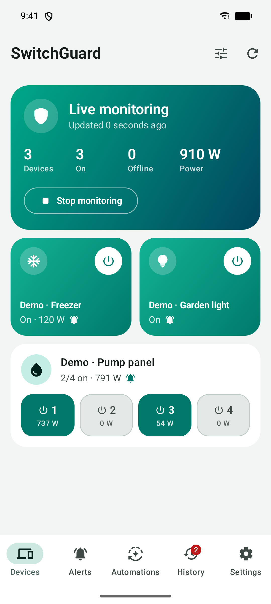
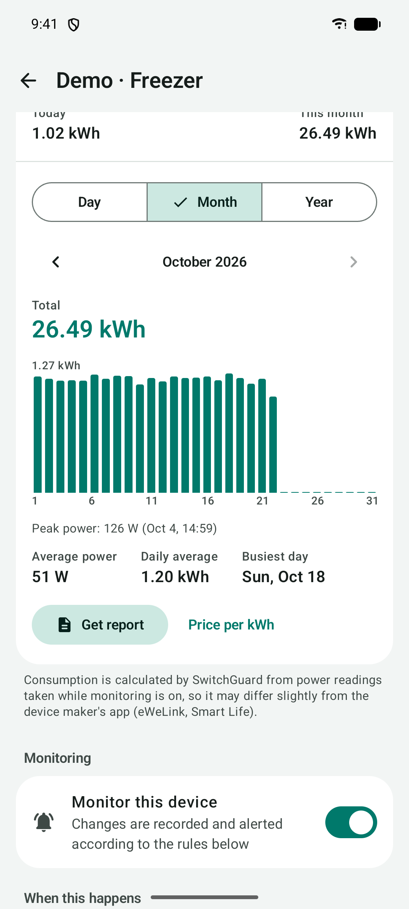
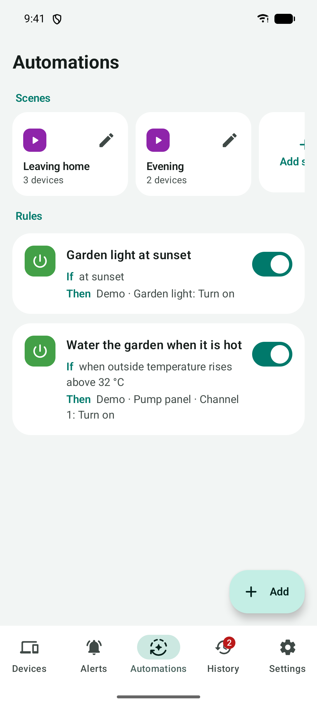
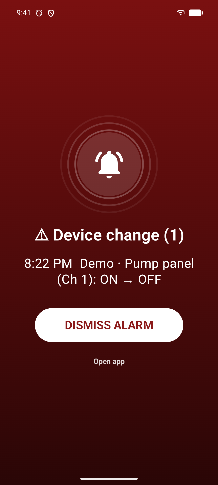

# SwitchGuard

Android app that watches the smart plugs and switches in your own **eWeLink / SONOFF** and **Tuya / Smart Life** accounts and rings a real alarm the moment something changes — a pump that stopped, a freezer plug switched off, a device that lost its connection. Runs on phones, tablets and Android TV.

*Türkçe: eWeLink (SONOFF) ve Tuya / Smart Life hesaplarınızdaki priz ve anahtarları izler; kapandığında, açıldığında ya da bağlantısı koptuğunda siz kapatana kadar çalan bir alarm verir. Telefon, tablet ve Android TV'de çalışır.*

<p>
  
  
  
  
</p>

## Download / İndir

### Android (phone, tablet, TV)
- **Google Play** (closed test): https://play.google.com/apps/testing/com.macerce.switchguard
- **APK**: [latest Android release](https://github.com/Macerce/switchguard/releases/latest) — download `SwitchGuard-x.y.z.apk` and open it on the phone. If SwitchGuard is already installed from Google Play, uninstall it first (different signature). The GitHub version tells you when a newer one is out.

*Türkçe: Google Play'den ya da [son Android sürümünden](https://github.com/Macerce/switchguard/releases/latest) `SwitchGuard-x.y.z.apk` dosyasını indirip telefonda açın. Play'den kuruluysa önce onu kaldırın (imza farklı).*

### Windows 10 / 11
- **Installer**: [Windows releases](https://github.com/Macerce/switchguard/releases?q=Windows&expanded=true) — download `SwitchGuard-x.y.z-Kurulum.exe` from the newest one and run it. The app checks for new versions and updates itself with one click; settings are kept.
- Without a license one device is monitored; a **Pro license key** (Settings → plan card) monitors all of them. For a key contact **switchguardapp@gmail.com**.

*Türkçe: [Windows sürümlerinden](https://github.com/Macerce/switchguard/releases?q=Windows&expanded=true) en yenisinin `SwitchGuard-x.y.z-Kurulum.exe` dosyasını indirip çalıştırın. Uygulama yeni sürümleri kendisi bulur ve tek tıkla günceller; ayarlar korunur. Lisanssız 1 cihaz izlenir; tümü için **Pro lisans anahtarı** gerekir (Ayarlar → plan kartı) — **switchguardapp@gmail.com**.*

## Features
- Smart-home style home screen: device tiles with quick power buttons, one button per channel on multi-channel devices, live status and power
- Alarm that keeps ringing until dismissed, even in silent mode, full screen on the lock screen; a different sound per device
- Live updates over the eWeLink WebSocket, with HTTP resync and polling fallback
- Per-device rules (alarm / notification / ignore) for off, on, offline and online
- Alert categories (Critical / Important / Normal): set by hand or automatically from the rules (a device with an alarm rule becomes Critical); filter the Alerts tab by category, choose per category whether it rings during quiet hours, and trigger automations or conditional alerts on a whole category ("any critical device goes offline")
- Groups: switch several devices or channels with one button and use the group in automations; drag tiles to reorder
- Offline grace period, quiet hours, remote on/off, eWeLink device timers, automations
- Energy history by day, month and year with cost (single or three-rate tariff), standby consumption and PDF/CSV reports
- Smart alerts: one alert for a power outage (all devices offline together, or the phone unplugged), unusual consumption, monthly budget, weekly report
- At home / Away and vacation mode; scenes; automations on sunrise, sunset, outside temperature, sustained power, with hour/day and "and if" limits
- Daily summary and full event history; device widget; app shortcuts (long-press the icon: At home / Away, scenes); Wear OS watch app
- Loud warning when the eWeLink session is lost (e.g. same account signed in on another phone)
- Telegram: tell the people you choose (in stages) if an alarm isn't dismissed in time, commands (/status, /on, /off, /scene, /away …), an "I've seen it" button and a watchdog message
- Free for 1 device; a one-time Pro purchase on Google Play monitors all devices
- No server, no analytics, no ads — everything stays on the phone ([privacy policy](https://sites.google.com/view/switchguard-privacy))

## Several devices / Birden fazla cihaz
Phone, tablet and Android TV: **each device needs its own eWeLink account with the developer feature approved, and that account's own API keys (App ID / Secret)** — eWeLink allows one signed-in device per account, and the keys must belong to the signed-in account. Share your devices to the extra account in the eWeLink app. Pro is bought once and works on all devices with the same Google account. Details: [English](docs/guide/ewelink.en.md#using-several-devices-phone-tablet-android-tv) · [Türkçe](docs/guide/ewelink.tr.md#birden-fazla-cihazda-kullanım-telefon-tablet-android-tv)

## Requirements
- Android 8.0+ (API 26)
- A free eWeLink developer app (App ID + App Secret) from [dev.ewelink.cc](https://dev.ewelink.cc) — the in-app guide walks you through it
- eWeLink allows one session per account and App ID: give each phone its own eWeLink account and share the devices from the eWeLink app

## Build
```
./gradlew assembleDebug          # debug APK
./gradlew testDebugUnitTest      # unit tests
```
Release builds need a `keystore.properties` + keystore in the project root (not in the repo).

## Setup guides / Kurulum rehberleri
- eWeLink (SONOFF): [English](docs/guide/ewelink.en.md) · [Türkçe](docs/guide/ewelink.tr.md)
- Tuya / Smart Life: [English](docs/guide/tuya.en.md) · [Türkçe](docs/guide/tuya.tr.md)

## Videos / Videolar
- **New in 2.17 – alert categories, critical alerts, groups (EN):** https://youtube.com/shorts/iVM3zEiBt8A
- **2.17 yenilikleri – uyarı kategorileri, kritik uyarılar, gruplar (TR):** https://youtube.com/shorts/Qha83ziwylI
- New in 2.15 – smart alerts, scenes, energy reports (EN): https://youtube.com/shorts/bOtFBjHoefE
- 2.15 yenilikleri – akıllı uyarılar, sahneler, enerji raporu (TR): https://youtube.com/shorts/y3QRZvVoeK4
- New in 2.12 – a tour of the app (EN): https://youtube.com/shorts/jvm0hx0gATk
- 2.12 yenilikleri – uygulama turu (TR): https://youtube.com/shorts/2KeUgJrCCEU
- First setup in one minute / İlk kurulum (1 dk): https://youtube.com/shorts/jarBmMg2kYA
- **Getting eWeLink API keys / eWeLink API anahtarlarını alma (TR, sesli):** https://youtu.be/G5vQ_7CXTcM
- **Getting Tuya API keys / Tuya API anahtarlarını alma (TR, sesli):** https://youtu.be/8vPjJMoMaMU

## Changelog / Sürüm geçmişi
[English](CHANGELOG.md) · [Türkçe](CHANGELOG.tr.md) · [Releases](https://github.com/Macerce/switchguard/releases)

## Contact
Questions, bug reports and feedback: **switchguardapp@gmail.com** (or open an issue here).

## License / Lisans
Source code: [PolyForm Noncommercial 1.0.0](LICENSE). Personal and other noncommercial use is free; selling the code or using it commercially is not permitted. Versions up to and including 2.8.3 were released under GPL-3.0.
Official builds (Google Play, [Releases](https://github.com/Macerce/switchguard/releases)) may be used by anyone, including businesses. For commercial licensing contact **switchguardapp@gmail.com**. Modified versions must not use the SwitchGuard name or logo.

Kaynak kod: [PolyForm Noncommercial 1.0.0](LICENSE). Kişisel ve ticari olmayan kullanım serbesttir; kodu satmak veya ticari amaçla kullanmak yasaktır. 2.8.3 ve önceki sürümler GPL-3.0 ile yayımlanmıştı.
Resmi sürümleri (Google Play, Releases) işletmeler dahil herkes kullanabilir. Ticari lisans için: **switchguardapp@gmail.com**. Değiştirilmiş sürümler SwitchGuard adını ve logosunu kullanamaz.

SwitchGuard is an independent project and is not affiliated with eWeLink, CoolKit or ITEAD.
