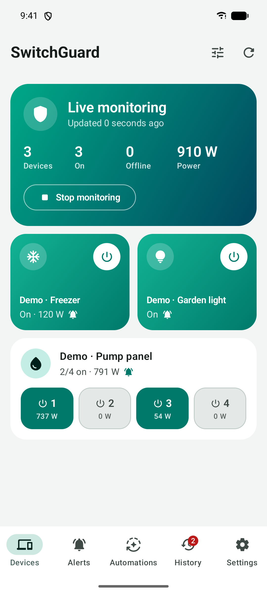
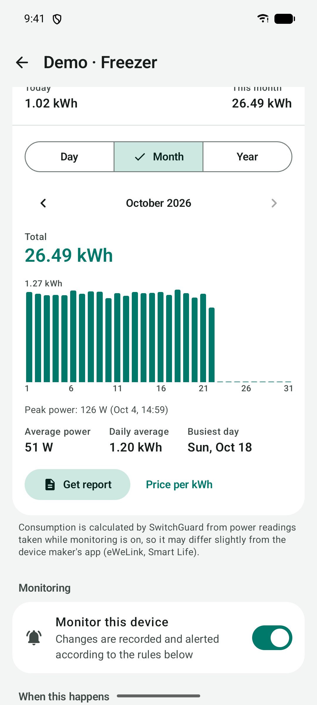
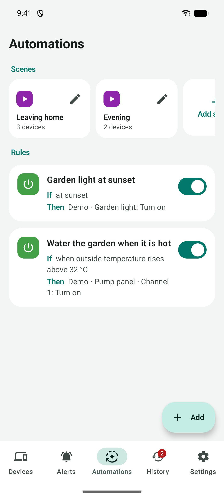
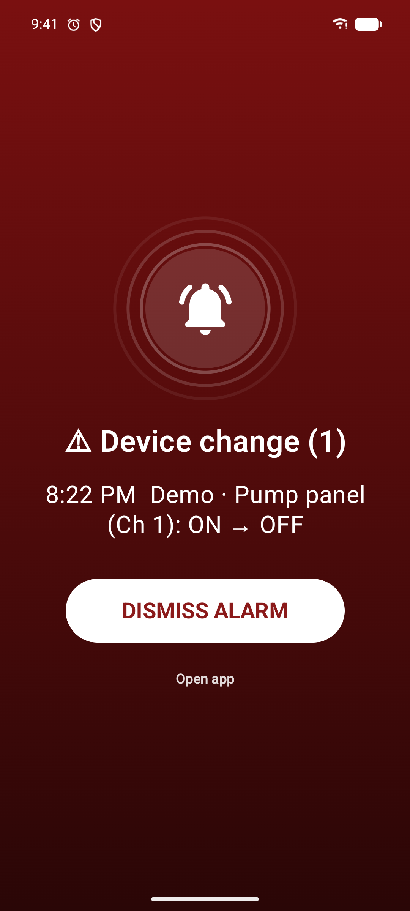

**English** · [Türkçe](README.tr.md) · [Deutsch](README.de.md) · [Español](README.es.md) · [Português (Brasil)](README.pt-BR.md) · [Français](README.fr.md) · [Italiano](README.it.md) · [Nederlands](README.nl.md) · [Polski](README.pl.md) · [Русский](README.ru.md) · [Українська](README.uk.md) · [العربية](README.ar.md) · [हिन्दी](README.hi.md) · [Bahasa Indonesia](README.id.md) · [Tiếng Việt](README.vi.md) · [ไทย](README.th.md) · [简体中文](README.zh-CN.md) · [繁體中文](README.zh-TW.md) · [日本語](README.ja.md) · [한국어](README.ko.md)

# SwitchGuard

SwitchGuard watches the smart plugs and switches in your own **eWeLink / SONOFF** and **Tuya / Smart Life** accounts and rings a real alarm the moment something changes — a pump that stopped, a freezer plug switched off, a device that lost its connection. It runs on Android phones, tablets, Android TV and Wear OS watches, and there is a Windows app too.

<p>
  
  
  
  
</p>

> **Languages:** the Windows app is available in 20 languages from 0.13.0. On Android, the in-app language choice (20 languages) comes with **2.26**; the latest Android release is 2.25.0.

## Download

### Android (phone, tablet, TV)
- **Google Play**: https://play.google.com/store/apps/details?id=com.macerce.switchguard
- **APK**: [latest Android release](https://github.com/Macerce/switchguard/releases/latest) — download `SwitchGuard-x.y.z.apk` and open it on the phone. If SwitchGuard is already installed from Google Play, uninstall it first (different signature). The GitHub version tells you when a newer one is out.

### Windows 10 / 11
- **Installer**: [Windows releases](https://github.com/Macerce/switchguard/releases?q=Windows&expanded=true) — download `SwitchGuard-x.y.z-Kurulum.exe` from the newest one and run it. The app checks for new versions and updates itself with one click; settings are kept.

### Free and Pro
- Free: every feature, for 1 monitored device. Demo devices let you try everything without hardware.
- Android: Pro is a one-time Google Play purchase (no subscription) and monitors all devices; it follows your Google account to a new phone.
- Windows: a Pro license key (Settings → plan card) monitors all devices. For a key, contact **switchguardapp@gmail.com**

## Requirements

- Android 8.0+ (API 26); Wear OS for the watch app
- eWeLink: a free eWeLink developer app (App ID + App Secret) — the in-app guide walks you through it. eWeLink allows one session per account and App ID, so each phone, tablet, TV or PC needs its own eWeLink account with the devices shared to it ([dev.ewelink.cc](https://dev.ewelink.cc))
- Tuya / Smart Life: the Access ID and Access Secret of your own free Tuya Cloud project, linked to your Smart Life / Tuya app account ([platform.tuya.com](https://platform.tuya.com))
- Windows 10 / 11 (64-bit) for the Windows app

## Setup guides

- eWeLink (SONOFF): [English](docs/guide/ewelink.en.md) · [Türkçe](docs/guide/ewelink.tr.md)
- Tuya / Smart Life: [English](docs/guide/tuya.en.md) · [Türkçe](docs/guide/tuya.tr.md)

### Videos

- **New in 2.17 – alert categories, critical alerts, groups (EN):** https://youtube.com/shorts/iVM3zEiBt8A
- **2.17 yenilikleri – uyarı kategorileri, kritik uyarılar, gruplar (TR):** https://youtube.com/shorts/Qha83ziwylI
- New in 2.15 – smart alerts, scenes, energy reports (EN): https://youtube.com/shorts/bOtFBjHoefE
- 2.15 yenilikleri – akıllı uyarılar, sahneler, enerji raporu (TR): https://youtube.com/shorts/y3QRZvVoeK4
- New in 2.12 – a tour of the app (EN): https://youtube.com/shorts/jvm0hx0gATk
- 2.12 yenilikleri – uygulama turu (TR): https://youtube.com/shorts/2KeUgJrCCEU
- First setup in one minute / İlk kurulum (1 dk): https://youtube.com/shorts/jarBmMg2kYA
- **Getting eWeLink API keys / eWeLink API anahtarlarını alma (TR, sesli):** https://youtu.be/G5vQ_7CXTcM
- **Getting Tuya API keys / Tuya API anahtarlarını alma (TR, sesli):** https://youtu.be/8vPjJMoMaMU

## Features

### Monitoring and alarm

- Live updates over the eWeLink WebSocket and the Tuya message service, with HTTP resync and periodic checks as a fallback.
- The alarm keeps ringing until you dismiss it — even in silent mode — and opens full screen over the lock screen; each device can have its own sound.
- Per-device rules: alarm, notification or nothing when a device turns off, turns on, goes offline or comes back online.
- Conditional alerts: ring when a device stays on or off for a while, or its power goes above / drops below a limit (e.g. a pump drawing under 50 W).
- Ignore brief disconnections, warning when monitoring itself stops (no internet / cloud), a loud warning when the eWeLink session is lost (e.g. the same account signed in on another phone).
- A readiness card shows and fixes phone settings that could stop the alarm (battery restriction, full-screen permission, Do Not Disturb, alarm volume…).

### Devices

- Smart-home style tiles with quick power buttons, one button per channel on multi-channel devices, live status and power.
- Device page: rules, own alarm sound, alert category, energy history and cost, eWeLink device timers, Wi-Fi signal and drop diagnosis, standby consumption and recent events.
- **Arrange devices**: Star = keep at the top · arrows = move · card size = small or large · tag = category. Long-press a card to come back here.

### Alerts

- Device alerts and conditional alerts in one place, with filters by alert category (Critical / Important / Normal).
- Alert settings: alarm sound and volume, quiet hours, alert categories, Telegram ("Tell someone else") and smart alerts — see *All settings* below.
- Smart alerts: one alert for a power outage, unusual consumption, monthly budget, weekly report, vacation mode.

### Automations

- **Rules** — automatic actions: *If* something happens, *then* do something, with an optional delay.
- Triggers: turns on, turns off, stays on for, stays off for, goes offline, comes back online, power goes above, power drops below, at sunrise, at sunset, when outside temperature rises above, when outside temperature drops below, on arrival, on leaving.
- Actions: Turn on, Turn off, Ring alarm, Send notification, Run scene, Start cycle, Stop cycle.
- **Only when**: Only during these hours, And only if another device…, Only when at home / away.
- **Scenes** — Choose what happens to each device when the scene runs. Devices left on “Skip” are not touched.
- **Groups** — Pick the devices in the group. The group shows up on the Devices screen like a device: its button turns them all on or off together, and you can use it in automations.
- **Cycles & timers** — Countdown, On, then off, On/off cycle, One by one, Custom steps. Start with a button, at a set time on chosen days or during a time window; optional random variation (lived-in look) and "stop when changed by hand".
- Automations run on this phone while monitoring is on. For schedules that must work even when the phone is off, use the timers on the device page.

### Energy

- Day / month / year view with total, estimated cost, average and peak power, busiest hour/day/month and a highlights summary.
- Single-rate or three-rate tariff (day / peak / night), a price per device or a default price.
- Standby consumption (the power a device never goes below) and its monthly cost.
- Energy report as PDF (to print or share) or CSV (Excel, Google Sheets).
- Consumption is calculated by SwitchGuard from power readings taken while monitoring is on, so it may differ slightly from the device maker's app (eWeLink, Smart Life).

### History

- Every event with date and time, who or what changed it (app, automation), filter by device.
- Export to CSV (last 24 hours, 7 days, 30 days or everything) and clear history.

### Chat

- Hello. You can manage your devices by writing: switch them on or off, ask their status, power use or the outdoor temperature. Tap the microphone to say it instead (“Turn off kitchen”); the reply is read aloud. Ready-made templates are below; tap one to send it, hold it to edit.
- Free-text commands work offline and understand English and Turkish; the microphone uses the phone's speech recognition and replies can be read aloud.
- Templates: one-tap messages that can also run automatically every day at a time or when something happens.

### Standby screen

- A full-screen board for a phone or tablet on charge: clock, weather, critical status, live power, recent activity and what runs next. It also shows over the lock screen.
- Opens Android settings: choose SwitchGuard under Screen saver and set it to start while charging. The board then replaces the lock screen while on the charger.

### Widgets, quick settings tile, shortcuts

- **SwitchGuard** — Shows whether monitoring is running and any ringing alarm
- **SwitchGuard switch** — Turns one device or channel on and off with a tap. It can also be set to At home / Away or to run a scene.
- **SwitchGuard group** — Large tile: switch each device in a group on or off on its own
- **SwitchGuard voice command** — One tile: tap, say it (“Turn off kitchen”), and it runs
- **Quick settings tile** — shows the monitoring status and starts or stops monitoring (the phone must be unlocked first); while an alarm rings it opens the app.
- **App shortcuts** — long-press the app icon for At home / Away and your scenes.

### At home / Away

- **At home / Away** — Rules marked "only when away" do not run. Switch to Away when you leave (also from the widget, the watch or Telegram /away).
- **Vacation mode** — You count as away, quiet hours are off and a report arrives every morning at 09:00. It ends by itself.
- **Zones** — Pick an area on the map; automations run when your phone enters or leaves it (e.g. turn on the garden light when you get home, turn everything off when you leave). Map images are downloaded from OpenStreetMap; your location is only used on this phone.

### Wear OS

- The SwitchGuard watch app shows alarms (dismiss from the wrist), devices (switch them), scenes and At home / Away; it connects to the phone app.

### Android TV

- Runs on Android TV with remote-control navigation; the alarm appears on top of whatever is playing ("Show alarm over other apps").
- "Enter from phone": the TV shows a QR code; type the keys on your phone and they go to the TV encrypted over your home Wi-Fi.
- "Receive from another device": copy Tuya keys, rules and settings from your phone over Wi-Fi.

### Several devices

Phone, tablet, Android TV and PC: **each device needs its own eWeLink account with the developer feature approved, and that account's own API keys (App ID / Secret)** — eWeLink allows one signed-in device per account. Share your devices to the extra account in the eWeLink app. Tuya keys can be used on several devices. Pro is bought once and works on all Android devices with the same Google account. Details: [English](docs/guide/ewelink.en.md#using-several-devices-phone-tablet-android-tv) · [Türkçe](docs/guide/ewelink.tr.md#birden-fazla-cihazda-kullanım-telefon-tablet-android-tv)

### Demo & Pro

- **Demo devices** — Virtual devices for trying every feature. These act as if something happened at the device itself (someone switched it, the power or Wi-Fi went out), so your rules apply and the alarm can ring. Switching with the buttons above counts as you and does not ring the alarm.
- The free version monitors 1 device. Pro monitors all your devices, with every feature. One-time payment, no subscription. Linked to your Google account, so it moves with you to a new phone.

## All settings

Everything below is in the order shown in the app. The **Settings** tab holds connections and app options; alarm, quiet hours, Telegram and smart alerts are under the **Alerts** tab → Alert settings; per-device options are on each device's page.

### Settings → Accounts

| Setting | What it does |
|---|---|
| Pro / Get Pro | The free version monitors 1 device. Pro monitors all your devices, with every feature. One-time payment, no subscription. Linked to your Google account, so it moves with you to a new phone. |
| Restore | Checks your Google Play purchases again (new phone, reinstall). |
| eWeLink — Sign in with eWeLink | Opens eWeLink's own sign-in page; the app never sees your password. |
| API credentials | App ID, App Secret and region of your eWeLink developer app. |
| Sign out | Monitoring will stop. Your settings and history are kept. |
| Tuya / Smart Life | Enter the Access ID and Access Secret of your Tuya Cloud project (platform.tuya.com → Cloud → your project → Overview). Your Smart Life / Tuya app account must be linked to the project. Data center: Central Europe, Western America, China, India |
| Disconnect | Removes the Tuya connection; Tuya devices are no longer monitored. |
| Demo devices | Virtual devices for trying every feature |

### Settings → Monitoring

How SwitchGuard keeps watch over your devices in the background.

| Setting | What it does |
|---|---|
| Maximum reliability | Keeps the processor awake so no event is ever delayed. Uses more battery. |
| Ignore brief disconnections | Wait this long before alerting that a device went offline. If it comes back in time, no alert is raised. |
| Warn if monitoring stops | No internet or no cloud connection for this long: you get a warning |
| Backup check interval | Used only when instant updates aren't available. |

### Settings → Permissions

Without these, Android may keep the alarm from reaching you.

| Setting | What it does |
|---|---|
| Notifications | Alarms and warnings can't be shown. |
| Background activity | The phone may put monitoring to sleep; alarms can be late or missed. |
| Full-screen alarm | With the phone locked, the alarm can't open its large screen. |
| Lock screen alarm (Xiaomi) | With the phone locked, the alarm screen can't open. Tap Fix, open Other permissions and turn on “Show on Lock screen” and “Open new windows while running in the background”. |
| Show alarm over other apps | Needed on Android TV so the alarm appears on top of whatever is playing. Tap and allow SwitchGuard. |
| Background start (Xiaomi, Huawei, OPPO, vivo…) | Shown on phones that block background start (Xiaomi, Huawei, OPPO, vivo…): lets monitoring restart after a reboot or update. See Troubleshooting. |

### Settings → Location and zones

| Setting | What it does |
|---|---|
| Location | Needed for sunrise/sunset and outside temperature rules. It stays on this device; for the temperature it is sent to Open-Meteo rounded to about 100 m. |
| Zones | Pick an area on the map; automations run when your phone enters or leaves it (e.g. turn on the garden light when you get home, turn everything off when you leave). Map images are downloaded from OpenStreetMap; your location is only used on this phone. |

### Settings → Standby screen

| Setting | What it does |
|---|---|
| Open standby screen | Tap the screen for “Open app” and “Close” |
| Use as screen saver | Opens Android settings: choose SwitchGuard under Screen saver and set it to start while charging. The board then replaces the lock screen while on the charger. |
| Dim at night | Text fades between 23:00 and 07:00 |

### Settings → Daily summary

| Setting | What it does |
|---|---|
| Daily summary notification | How many times each device turned on, how long it stayed on and how much energy it used today |
| Send at | The time of day the summary is sent. |
| Show today’s summary now | Shows it right now. |

### Settings → Backup & transfer

| Setting | What it does |
|---|---|
| Back up to a file | Rules, automations, settings and the Tuya and eWeLink keys go into a password-protected file |
| Restore from a file | Moving to a new phone? Pick the backup file and enter its password |
| Send to another device | Copy Tuya keys, rules and settings to a TV or tablet on the same Wi-Fi |
| Receive from another device | Get the setup from your phone over Wi-Fi |

Wi-Fi transfer never sends the eWeLink API keys or the eWeLink session: on the other device, enter that device's own API keys and sign in with its own eWeLink account. A file backup does include the eWeLink and Tuya keys, protected by your password.

### Settings → Language

| Setting | What it does |
|---|---|
| Language | Choose the language of the app, notifications and alarms. Phone language or one of 20 languages (from 2.26). |

### Settings → Help & about

| Setting | What it does |
|---|---|
| Setup guide | Show the first-run setup again |
| eWeLink setup guide | Step-by-step with pictures (GitHub) |
| Tuya / Smart Life setup guide | Step-by-step with pictures (GitHub) |
| Send a problem report | Something wrong? Prepares an email with diagnostic details. Nothing is shared unless you send it. |
| Delete saved crash reports | Deletes the crash reports saved on this device. |
| Contact & feedback | Writes an email to the developer (questions, bugs, ideas). |
| Privacy policy | Opens the privacy policy. |
| About | Version, legal note. The GitHub build checks GitHub for a newer version. |

### Alerts

| Setting | What it does |
|---|---|
| Device alerts | What each device rings or notifies for |
| Conditional alerts | Ring when a device stays on or off for a while, or its power changes |
| Alarm is ready / Alarms may not reach you | The readiness card at the top: lists phone settings that can stop the alarm and opens the right screen to fix them; also a Test alarm button. |

### Alerts → Alarm

| Setting | What it does |
|---|---|
| Alarm sound | General alarm sound. Each device can have its own (device page). |
| Alarm volume | SwitchGuard's own alarm volume. |
| Vibrate | Vibrate while the alarm rings. |
| Ring at full volume | Raises the phone's alarm volume to maximum while the alarm rings and pauses music; restored when you dismiss it |
| Ring again if not resolved | After you dismiss an alarm, it rings again at this interval while the device stays in the state that caused it (still off, still on or offline). Stops when the device is back to normal. |
| Tell someone else | Telegram setup (see below). |
| Test alarm | Try the alarm now: with sound or silently, right away or after 10 seconds |

### Alerts → Alert categories

Every device has an alert category. Unless you pick one it is set automatically: a monitored device with any event set to Alarm is Critical, one that only sends notifications is Important, the rest are Normal. Conditional alerts and automations can use a category as their trigger (e.g. “ring the alarm when any critical device goes offline”).

| Setting | What it does |
|---|---|
| Critical · Important · Normal · Auto | When automatic: Critical if any event rings an alarm, Important if events only notify |
| Ring during quiet hours too | Alarms ring during quiet hours too / During quiet hours alarms become notifications |

### Alerts → Quiet hours

| Setting | What it does |
|---|---|
| Quiet hours | During these hours alarms become notifications (critical devices still ring) |
| Starts / Ends | Start and end time of quiet hours. |

Devices in alert categories set to ring during quiet hours (Critical by default) still ring.

### Alerts → Tell someone else

If an alarm isn't dismissed in time, the people you choose get a Telegram message, and another one once it's dismissed. Even if your phone is in another room at night, someone at home or a neighbour finds out. The messages are sent by a Telegram bot you create; no other server is involved.

| Setting | What it does |
|---|---|
| 1. Telegram bot | In Telegram, open @BotFather, send /newbot and name your bot. Paste the token BotFather gives you below. |
| 2. People to tell | Ask each person to open @your_bot in Telegram and tap Start (you can also add the bot to a family group). Then tap Find people. |
| 3. When | How long an alarm may ring before people are told (or right away). |
| Send a test message | Sends a test message to everyone in the list. |
| Turn off | Turns Telegram notification off. |

### Alerts → Smart alerts

Alerts that look at all your devices together: power outages, unusual consumption and a weekly summary. With Telegram you can also check the status, take over an alarm and switch devices remotely.

| Setting | What it does |
|---|---|
| Power outage: Detect power outages | If all monitored devices go offline together, you get one “power outage” alert instead of one per device, and a message with the duration when power returns. |
| Charger as a power sensor | If this phone/tablet stays plugged in at the site, being unplugged for a minute counts as a power outage; it also works when the internet is gone. The message goes out by Telegram over mobile data. |
| At home / Away: Softer alerts at home | While at home, alarms of non-critical devices become notifications (like quiet hours). Critical devices always ring. |
| Vacation mode | You count as away, quiet hours are off and a report arrives every morning at 09:00. It ends by itself. |
| Consumption: Unusual consumption | Each morning, compares yesterday with the previous two weeks. Much higher use can mean a fault; much lower (a freezer that barely ran) can mean it stopped working. |
| Electricity tariff | The default price for devices without their own price. With a three-rate tariff each hour is priced in its own band: day 06–17, peak 17–22, night 22–06. |
| Monthly budget | You are notified once a month when the estimated cost of the energy-metering devices reaches this amount. |
| Weekly report | Every Monday at 09:00: outages, alarms and response time, disconnections and consumption of the past week. Also sent to Telegram if set up. |
| Show this week's report | Shows it right now. |
| Telegram: Commands and “Got it” button | People in your list can send /status and take over a ringing alarm. The alarm message gets a “Got it” button: pressing it silences the phone. |
| Allow turning devices on and off | /on and /off commands. Only people in your list can use them. |
| Staged notification | Each person is messaged after their own wait. For example a neighbour after 5 minutes, a relative after 15, the family group after 30. If someone taps “Got it”, the next people are not messaged. |
| Call on critical alarm | When a device in the Critical category sounds the alarm, the person is also called from this phone's line when their wait in staged alerts is up. The call only wakes them up: what happened is in the Telegram message sent at the same time (Android doesn't let apps play sound into a phone call). Ask them to save this number as “SwitchGuard alarm”. Calls repeat every 2 minutes, up to 3 times, until the alarm is dismissed or someone taps “Got it” in Telegram. Groups can't be called. |
| Send smart alerts to Telegram | Power outages, unusual consumption, the budget alert and the weekly report are also written to Telegram. |
| Watchdog | Two devices with the same bot watch each other (e.g. the phone and a TV box). The sending device keeps a pinned message in the Telegram chat up to date; the watching device raises an alarm and messages your contacts if it stops. Do not unpin that message. |

### Device page (tap a device)

| Setting | What it does |
|---|---|
| Monitor this device | Changes are recorded and alerted according to the rules below |
| When this happens | Turns off, Turns on, Goes offline, Comes online → Alarm / Notify / None. Alarm rings until you dismiss it. Notify shows a normal notification. None only records the event in history. |
| Sound for this device | Its own alarm sound; otherwise the general sound. |
| Alert category | When automatic: Critical if any event rings an alarm, Important if events only notify |
| Energy | Power, voltage, current; today and this month; day / month / year history with cost; Get report (PDF / CSV). |
| Price per kWh | Price per kWh for this device, or the default price; can also be set as the default. |
| Timers (on the device) | No timers. Timers run on the device itself, even when your phone is off. (eWeLink devices: add or edit on/off timers at a set time on chosen days.) |
| Connection | dBm is signal strength: closer to 0 is better. Above -55 excellent, down to -67 good, down to -75 fair, below that weak. |
| Standby consumption | The lowest hourly average of the last 7 days: the power this device (and anything plugged into it) never goes below, even when "doing nothing". TVs, modems and chargers often draw this in standby. |
| Copy device data | Copies the device’s raw data to the clipboard, useful for reporting an unsupported model |

## Telegram commands

People in your list can send /status and take over a ringing alarm. The alarm message gets a “Got it” button: pressing it silences the phone.

```
SwitchGuard commands:
/status – monitoring, alarm and devices
/ack – take over the ringing alarm
/on name [channel] – turn a device or group on (several: /on kitchen, garden)
/off name [channel] – turn a device or group off
/watt [name] – power now, today and usual draw
/temp – outdoor temperature
/scene name – run a scene
/home · /away – set at home / away

You can also write freely: “turn off kitchen and garden”, “heater watts”, “is the pump on”.

Turning devices on and off and scenes must be allowed in the app (Alerts → Smart alerts).
```

English and Turkish command names both work (e.g. /status = /durum, /on = /ac). Commands are only accepted from the chats you picked.

## Permissions and why

| Permission | Why |
|---|---|
| `POST_NOTIFICATIONS` | Show alarms, notifications and the monitoring status. |
| `FOREGROUND_SERVICE` | Keep monitoring running in the background (the permanent status notification). |
| `REQUEST_IGNORE_BATTERY_OPTIMIZATIONS` | Ask to be exempt from battery optimisation so alarms are not delayed. |
| `USE_FULL_SCREEN_INTENT` | Open the alarm full screen over the lock screen. |
| `SYSTEM_ALERT_WINDOW` | Show the alarm over other apps (Android TV, Xiaomi). |
| `WAKE_LOCK` | Keep the processor awake while handling events ("Maximum reliability"). |
| `VIBRATE` | Vibrate during the alarm. |
| `RECEIVE_BOOT_COMPLETED` | Restart monitoring after the phone restarts. |
| `INTERNET` | Talk to the eWeLink / Tuya cloud (and Telegram / Open-Meteo / OpenStreetMap if you use them). |
| `ACCESS_COARSE_LOCATION` | Only when you tap "Use this device's location" for sunrise/sunset and temperature rules. |
| `ACCESS_FINE_LOCATION` | Zones: an exact area for arrival / leaving rules. |
| `ACCESS_BACKGROUND_LOCATION` | Zones: notice arrivals and departures while the app is closed (asked only when you create a zone). |
| `CALL_PHONE` | "Call on critical alarm": call the number you entered from this phone's line. |

## Privacy

- No server of its own, no analytics, no ads, no tracking. Nothing is sold or shared.
- Keys, tokens, devices, rules, settings and history (max. 2,000 events) are stored only on your device.
- The app talks only to the clouds you connect (eWeLink `*.coolkit.cc` / `*.coolkit.cn`, Tuya `openapi.tuya*.com`) and, only if you use them, Telegram, Open-Meteo (temperature and weather, location rounded to about 100 m) and OpenStreetMap map tiles.
- Your eWeLink password is typed on eWeLink's own page; the app never sees it.
- App data is excluded from Android cloud backup; file backups are password-protected; Wi-Fi transfer is encrypted with a one-time code and stays in your home network.
- Pro purchases are handled by Google Play.

Full privacy policy: [Google Sites](https://sites.google.com/view/switchguard-privacy) · [docs/privacy-policy.md](docs/privacy-policy.md)

## Troubleshooting and FAQ

### The alarm is late or doesn't ring

| Problem | What to do |
|---|---|
| Background activity is restricted | The phone may put monitoring to sleep; alarms can be late or missed. |
| Full-screen alarm is not allowed | With the phone locked, the alarm can't open its large screen. |
| Xiaomi blocks the alarm screen | With the phone locked, the alarm screen can't open. Tap Fix, open Other permissions and turn on “Show on Lock screen” and “Open new windows while running in the background”. |
| Alarm notifications are turned down | The “Alarms” notification category isn't set to high priority, so the alarm won't pop up or fill the screen. |
| Do Not Disturb: total silence | In this mode even alarm sounds are muted. |
| Alarm volume is very low | The phone's alarm volume is at or near zero, so you may not hear SwitchGuard. Fix turns on “Ring at full volume”. |
| Notifications are off | Alarms and warnings can't be shown. |
| There's a second SwitchGuard on this phone | Another copy of SwitchGuard was made with the phone's Dual apps (app clone) feature. Two copies running side by side ring every alarm twice and sign each other out when they use the same eWeLink account; on Xiaomi phones this copy's permissions can also appear switched off. Remove the second copy: touch and hold its icon (the one with the small badge) and tap Uninstall. |

### Phone makers that stop background apps

| Phone | What to do |
|---|---|
| Xiaomi | Needed so monitoring restarts after a reboot or update. Tap and turn on Autostart for SwitchGuard. |
| Samsung | Samsung may put the app to sleep. In Battery, choose "Unrestricted" and add SwitchGuard to "Never sleeping apps" (Battery → Background usage limits). |
| Huawei / Honor | In App launch, set SwitchGuard to "Manage manually" and turn on Auto-launch, Secondary launch and Run in background. |
| OPPO / realme / OnePlus | Turn on Auto launch for SwitchGuard, then in its Battery settings allow background activity. |
| vivo / iQOO | Allow SwitchGuard to start in the background and allow high background power consumption. |
| Tecno / Infinix | Turn on Auto-start for SwitchGuard in Phone Master so monitoring survives reboots and cleanups. |
| ASUS | Allow SwitchGuard in Auto-start Manager so monitoring restarts after a reboot. |

### Other questions

**Monitoring stopped and says I was signed out.**  
Tip: eWeLink allows one session per account. Give each phone its own eWeLink account and share the devices from the eWeLink app.

**A Tuya device shared with me is missing.**  
A device shared with you is missing? Tuya only lists the devices in your homes. Ask the owner to add you as a home member in Smart Life (Me → Home Management → Add Member).

**Tuya devices stopped updating.**  
Tuya Cloud trial has expired, so Tuya devices are not being monitored. Extend it at platform.tuya.com → Cloud → IoT Core → Extend trial period.

**Changes arrive late / "Instant updates unavailable".**  
Instant updates unavailable for this App ID; using periodic checks (changes shorter than the interval may be missed)

**Can I switch between the Google Play and GitHub versions?**  
Yes, but uninstall the other one first: they are signed differently. Back up to a file before uninstalling and restore it afterwards.

**How can I check the alarm without waking everyone?**  
Try the alarm now: with sound or silently, right away or after 10 seconds

**Why is the consumption different from the eWeLink / Smart Life app?**  
Consumption is calculated by SwitchGuard from power readings taken while monitoring is on, so it may differ slightly from the device maker's app (eWeLink, Smart Life).

## Windows app

SwitchGuard for Windows (10 / 11) does the same monitoring on a PC: it sits in the tray, rings a full-screen alarm on the computer and shares the same rules, automations and Telegram features. Zones, widgets, the watch and phone calls are phone-only.

### Features

- Same tabs: Devices, Alerts, Automations, History, Chat, Settings; voice commands in Chat use Windows voice typing.
- Tray icon: open, start / stop monitoring, dismiss alarm, exit; closing the window keeps monitoring.
- Full-screen alarm window, built-in sounds (Siren, Beep, Pulse, Chime) or your own WAV / MP3.
- Standby screen and Windows screen saver: the board opens when the PC is idle.
- A laptop left on the charger works as a power-cut sensor.
- One-click updates from GitHub; settings and license are kept. Backup to a password-protected file (cannot be restored on a phone).

### Windows-only settings

| Setting | What it does |
|---|---|
| Windows | So that SwitchGuard keeps watch on this computer without interruption. If either is off, alarms can be missed after a restart or while the computer sleeps. |
| Start with Windows | Opens in the tray when you sign in to Windows |
| Keep the computer awake | While monitoring, the computer does not go to sleep |
| Use as Windows screen saver | When the computer is idle the standby screen opens; moving the mouse or pressing a key closes it |
| Wait | How long the computer must be idle before the standby screen opens |
| Windows screen saver settings | E.g. “On resume, display logon screen” |
| Open standby screen | Full screen; Esc closes, click for “Open app”. The screen stays on while it is open. |
| Language & appearance: Theme | Light, dark or the same as Windows. |
| Language | Choose the language of the app, notifications and alarms. |
| Tuya live updates on this computer | Off: Tuya devices are checked every 5 minutes |
| Power cut when this computer goes on battery | For a laptop left plugged in at home: if it runs on battery for a minute, it counts as a power cut, even without internet (the Telegram message goes once the connection is back). |
| This computer is on the same power as the devices | While it runs on mains power there is no power cut, so a device that drops is reported right away instead of after up to 90 seconds. |
| Load from file… | Use your own WAV or MP3 for the alarm or notification (first 60 seconds, max 20 MB). |
| Back up to a file… | All settings, account keys and sounds in one password-protected file |
| Activate Pro | Without a license the app monitors 1 device. Enter your license key to monitor all your devices. |

### Installing on Windows

1. Double-click the setup file (SwitchGuard-…-Kurulum.exe). It does not ask for administrator rights and installs in a few seconds.
2. If Windows says "Windows protected your PC" (SmartScreen), press More info → Run anyway. The app is not signed yet; that is why it warns.
3. SwitchGuard is installed in your user folder (AppData › Local › SwitchGuard) and adds shortcuts to the desktop and the Start menu.
4. It starts by itself in the tray (next to the clock) when you sign in to Windows. Closing the window does not stop it; to quit, use the tray icon → Exit.
5. Add your accounts in Settings → Accounts (the Tuya and eWeLink steps are below).
6. Moving to another computer: on the old one, Settings → Backup & transfer → Back up to a file; install on the new one, Restore from a file, then sign in to eWeLink again.
7. To uninstall: Windows Settings → Apps → Installed apps → SwitchGuard → Uninstall.
8. Installing a new version: first uninstall the old one (step 7), then run the new setup file. Your settings, accounts and sounds are kept.

## Build

```
./gradlew assembleDebug          # debug APK
./gradlew testDebugUnitTest      # unit tests
```
Release builds need a `keystore.properties` + keystore in the project root (not in the repo).

## Changelog

[English](CHANGELOG.md) · [Türkçe](CHANGELOG.tr.md) · [Releases](https://github.com/Macerce/switchguard/releases)

## Contact

Questions, bug reports and feedback (or open an issue here): **switchguardapp@gmail.com**

## License

SwitchGuard is **source-available**, not open source. Source code: [PolyForm Noncommercial 1.0.0](LICENSE). Personal and other noncommercial use is free; selling the code or using it commercially is not permitted. Versions up to and including 2.8.3 were released under GPL-3.0.

Official builds (Google Play, [Releases](https://github.com/Macerce/switchguard/releases)) may be used by anyone, including businesses. Modified versions must not use the SwitchGuard name or logo. For commercial licensing contact **switchguardapp@gmail.com**

Not affiliated with, endorsed or sponsored by eWeLink, CoolKit or ITEAD. Sonoff and eWeLink are trademarks of their respective owners. Not affiliated with Tuya either.
