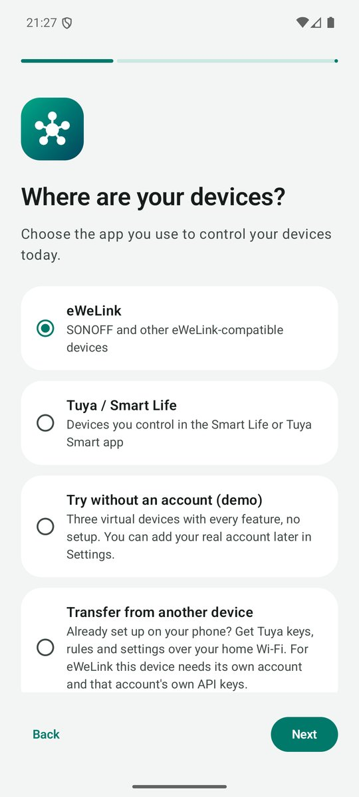
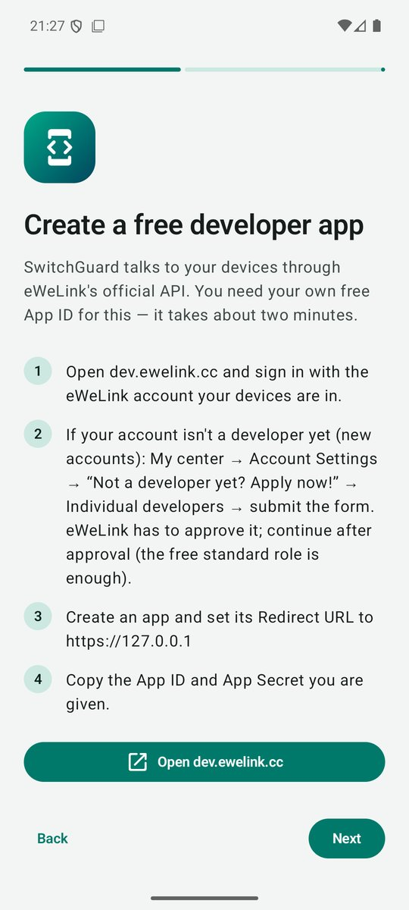
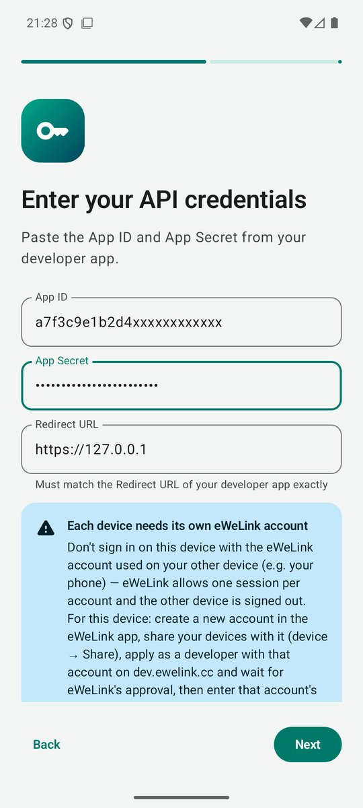
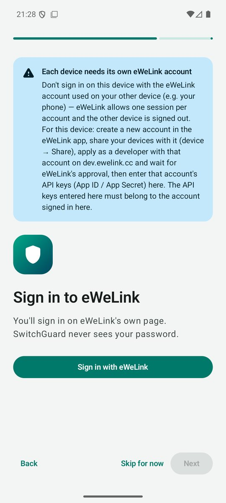
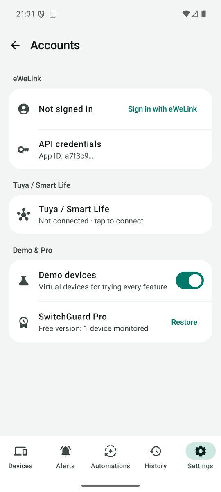

# SwitchGuard – eWeLink (SONOFF) setup guide

[Türkçe](ewelink.tr.md) · [Tuya / Smart Life guide](tuya.en.md)

This guide connects the SONOFF and other eWeLink-compatible devices you control in the **eWeLink** app to SwitchGuard, step by step. It takes about **2–5 minutes** and is free.

SwitchGuard talks to your devices through eWeLink's official API. For that you create **your own free app** (App ID + App Secret) on the eWeLink developer site. You sign in on eWeLink's own page; SwitchGuard never sees your password.

## Video walkthrough (3 min)

Watch every step in a short video (Turkish narration and captions): [open on YouTube](https://youtu.be/G5vQ_7CXTcM)

> **You need:** the eWeLink account your devices are in, and SwitchGuard. A computer is easier for the developer site, but a phone works too.

---

## 1. Open the eWeLink developer site

1. Go to **https://dev.ewelink.cc**.
2. Click **Login/Register** (top right) and sign in with **the eWeLink account your devices are in** (the same email/phone and password as in the eWeLink app).

3. After signing in, **Console** appears in the top menu; click it.

### If your account isn't a developer yet (new accounts)

New eWeLink accounts **are not registered as developers**. On **My center → Account Settings** you'll see *Account Identity: Ordinary users* and *Certification Status: Unverified*; until that changes you can't create an app in the Console.

1. Click **Not a developer yet? Apply now!**
2. Choose **Individual developers**.

3. Fill in **Name**, **E-mail** and **Occupation** → **Submit**.

4. **eWeLink has to approve your application.** You can't continue with step 2 until it's approved; after approval your account becomes a developer and you can create an app in the Console.

> **Every eWeLink account you create for extra devices (tablet, TV) must also apply and be approved.** The API keys (App ID and App Secret) are taken from that account's developer site; each device uses its own account's keys (see [Using several devices](#using-several-devices-phone-tablet-android-tv)).

## 2. Create an app

1. On the **App List** page click **Create** (top right).

2. Fill in the form:

| Field | What to enter |
|---|---|
| **App Name** | `SwitchGuard` (any name) |
| **App Profile** | a short description, e.g. `SwitchGuard alarm` |
| **App Type** | **OAuth2.0** |
| **App Role** | **Standard Role** (free) |
| **Redirect URL** | `https://127.0.0.1` — must match **exactly** (no trailing `/`, `https`) |

3. Click **OK**. The app appears in the **App List**.

> **The Redirect URL matters:** if the one in SwitchGuard and the one here are not identical, the sign-in page shows an error. SwitchGuard's default is `https://127.0.0.1`; the **Copy Redirect URL** button in setup copies it.
>
> **If nothing happens when you click Create:** the free standard role appears to allow a single app. If you already have one in the list, use it and set its Redirect URL to `https://127.0.0.1` with **Edit**.

## 3. Copy the App ID and App Secret

1. In the **App List** click **View** on your app's row.
2. Under **Authorization Key** copy the **APPID**.
3. Click the **eye** icon next to **APP SECRET** to reveal it, then copy it.

> Treat these two like a password; don't share them.
>
> **The app is valid for 1 year.** Before its **Expiration Date**, renew it on the developer site or create a new one and update the App ID/Secret in SwitchGuard (Settings → Accounts → API credentials).

## 4. Enter them in SwitchGuard

**During first setup:** at **Where are your devices?** choose **eWeLink** → **Next**.

| Choose eWeLink | Developer app step |
|---|---|
|  |  |

**Open dev.ewelink.cc** opens the site; **Copy Redirect URL** copies `https://127.0.0.1`.

**Next** → **Enter your API credentials** (note the **Each device needs its own eWeLink account** warning below the fields, see [Using several devices](#using-several-devices-phone-tablet-android-tv)):

1. **App ID:** paste the APPID from step 3.
2. **App Secret:** paste the App Secret.
3. **Redirect URL:** must be identical to the developer site (default `https://127.0.0.1`).

**Next** → **Sign in to eWeLink** → tap **Sign in with eWeLink**. eWeLink's own sign-in page opens; use your email/phone and password. When it works it says **"Signed in"**.

| API credentials | Sign in |
|---|---|
|  |  |

**Next** → grant permissions (notifications, background activity) → **Start monitoring**.

**To change later:** **Settings → Accounts → API credentials** (App ID/Secret) and **Sign in again**.

---

## Using several devices (phone, tablet, Android TV)

- **Each device needs its own eWeLink account. That account must have the developer feature enabled (approved by eWeLink), and the device gets that account's own API keys (App ID and App Secret).** The API keys entered on a device must belong to the eWeLink account signed in on that device.
- **The same API credentials (App ID / App Secret) can be signed in on only one device.** eWeLink allows one session per account: **the session stays active on the device where the credentials were entered and signed in most recently**, and the other device is signed out (SwitchGuard warns you loudly when that happens).
- For each extra device: 1) create a new account **in the eWeLink app** (eWeLink's sign-in page has no sign-up), 2) share your devices with it in the eWeLink app (**device → Share**), 3) with that account, [apply as a developer](#if-your-account-isnt-a-developer-yet-new-accounts) on dev.ewelink.cc and wait for approval, 4) after approval create an app in that account and enter its App ID and App Secret on that device.
- **Transferring the setup:** on the phone **Settings → Backup & transfer → Send to another device**, on the TV/tablet **Transfer from another device** (during setup) or **Settings → Backup & transfer → Receive from another device**. Both must be on the same Wi-Fi; enter the 6-digit code shown on the TV. Tuya keys, rules, automations and settings are sent inside your home network, encrypted with the code. eWeLink API keys and the session are not transferred — each device uses its own account's keys.
- **Signing in on a TV:** easiest is **Login by QR code** at the bottom of eWeLink's sign-in page — scan it with the eWeLink app signed in to the account you created for that device. The remote works too; the keyboard in the Google TV app on your phone is easier.
- **SwitchGuard Pro** is bought once and works on all your devices (phone, tablet, TV) with the same Google account.
- **Typing long keys on a TV:** in the API credentials window tap **Enter from phone**, scan the QR code with your phone and type the keys there; they are sent to the TV encrypted over your Wi-Fi.
- **Alarm on Android TV:** the alarm appears full screen on top of whatever is playing (YouTube, TV…) and is dismissed with the remote's OK button.

## Troubleshooting

| Symptom | Fix |
|---|---|
| The sign-in page shows a "redirect" / "invalid" error | Is the Redirect URL **exactly** the same on both sides? (`https://127.0.0.1`, no trailing `/`, `https` not `http`.) |
| Signed in but no devices | Did you sign in to the developer site and SwitchGuard with **the account your devices are in**? Is the region right? |
| Signing in on another phone signs the first one out ("Monitoring stopped — signed out" warning) | eWeLink allows one session per account. Give the second phone **its own eWeLink account** and **share** the devices to it from the eWeLink app. |
| Status card stays **"Monitoring (periodic)"** | Live connection may be unavailable for some App IDs; SwitchGuard keeps watching with regular checks. Adjust the frequency in **Settings → Monitoring → Backup check interval**. |

---

Questions? **switchguardapp@gmail.com** · [GitHub Issues](https://github.com/Macerce/switchguard/issues)
